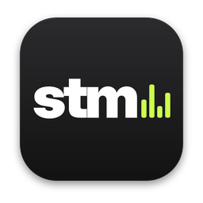
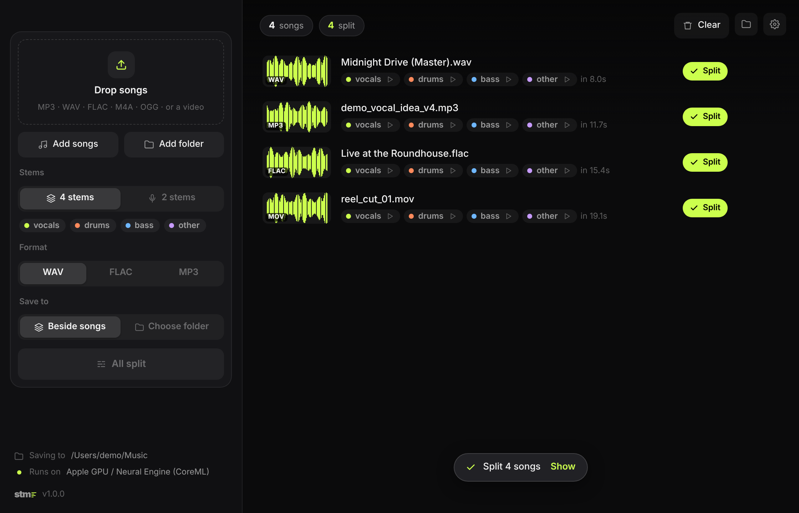

<p align="center">
  
</p>

<h1 align="center">stm</h1>

<p align="center">
  <b>Split any song into vocals, drums, bass and everything else.</b><br>
  Studio-quality stems from the Demucs model, running on your own GPU.<br>
  For macOS and Windows.
</p>

<p align="center">
  <a href="https://github.com/YuvrajxGarg/stm/releases/latest"></a>
  
  <a href="LICENSE"></a>
</p>

<p align="center">
  
</p>

## Download

| Platform | Download | First launch |
|---|---|---|
| **macOS** 12+ · Apple silicon | [**Stm.dmg**](https://github.com/YuvrajxGarg/stm/releases/latest/download/Stm.dmg) | Open it and drag **Stm** to Applications. The app isn't notarized, so the first time: right-click → **Open**. On macOS 15 and later, go to **System Settings → Privacy & Security → Open Anyway** instead. |
| **Windows** 10 / 11 · 64-bit | [**Stm-Setup.exe**](https://github.com/YuvrajxGarg/stm/releases/latest/download/Stm-Setup.exe) | Run the setup. It installs Stm for your account (no admin needed) and adds it to the Start menu. If SmartScreen appears, click **More info → Run anyway**. |

The model and ffmpeg come bundled, so there's nothing else to install. Stm checks this repository for new releases and updates itself. It's also in [PXL](https://github.com/YuvrajxGarg/pxl).

## How it works

1. **Drop** songs, folders, or videos (Stm uses their soundtrack).
2. **Pick** four stems (vocals, drums, bass, other) or two (vocals and instrumental), and WAV, FLAC or MP3.
3. **Split.** Each song gets a `Song (stems)` folder beside it, or in a folder you choose. Click a stem to play it. Originals are never touched.

## Under the hood

- **The model** is [Hybrid Transformer Demucs](https://github.com/facebookresearch/demucs) (`htdemucs`) from Meta AI Research, the one most stem tools use. It's exported to ONNX, so the app ships no PyTorch.
- **On your GPU.** ONNX Runtime runs it through **CoreML** on a Mac (GPU and Neural Engine) and **DirectML** on Windows (any DirectX 12 GPU: NVIDIA, AMD or Intel). If an accelerator can't take the model, Stm falls back to the CPU on its own. Settings can force the CPU.
- **Any length.** Songs are cut into overlapping 7.8-second chunks, the length the model was trained on, and the stems are cross-faded back together, the same overlap-add Demucs uses. Memory stays flat for a 3-minute single or a 2-hour DJ set.
- **Same result as Demucs.** The STFT and inverse STFT stay outside the ONNX graph (complex numbers don't travel well through CoreML or DirectML) and run in numpy. CI checks the whole pipeline against PyTorch Demucs on every change: the stems match it to rounding error.
- **Output** is 24-bit WAV or FLAC, or 320 kbps MP3, at 44.1 kHz.

## Command line

```bash
Stm split ~/Music/song.mp3                      # vocals, drums, bass, other as WAV
Stm split ~/Music/album -o ~/Desktop/stems --stems 2 --format flac
Stm split song.wav --stems drums                # drums + no_drums (a drumless backing track)
Stm info                                        # model and the device it runs on
```

`--device cpu` skips the GPU. On macOS the binary lives at `Stm.app/Contents/MacOS/Stm`. From source, run `python Stm.py …`.

## Build from source

You need Python 3.9+. On macOS, [uv](https://docs.astral.sh/uv/) is the easiest way to get it.

```bash
pip install -r requirements.txt
python tools/export_onnx.py        # once: needs  pip install -r tools/requirements-export.txt
python Stm.py
```

| | |
|---|---|
| **macOS app** | `./build_mac.sh` builds `dist/Stm.app` (and exports the model the first time). Add `--install` to copy it to `~/Applications`. |
| **Windows app** | `build_windows.bat` builds `dist\Stm\Stm.exe`. |
| **Tests** | `pip install onnx` then `python -m unittest discover tests` |

### Layout

```
stm/engine.py            ONNX Runtime session, provider choice, chunking and overlap-add
stm/dsp.py               the STFT / iSTFT around the network, in numpy
stm/audio.py             reading songs and writing stems through ffmpeg
stm/webapp.py            the window: HTML/CSS UI in a native WebKit / WebView2 view (pywebview)
stm/updater.py           GitHub Releases updater (check → download → verify → swap)
stm/ui/                  the interface
tools/export_onnx.py     htdemucs → models/htdemucs.onnx
Stm.spec                 PyInstaller recipe for both platforms
```

## Releasing

1. Bump `VERSION` and commit.
2. Tag and push:

   ```bash
   git tag v1.0.1 && git push origin v1.0.1
   ```

3. The **Release** workflow exports the model from the official Demucs weights, checks it against PyTorch, then builds, tests and smoke-tests both apps and attaches the installers (`Stm.dmg`, `Stm-Setup.exe`) and the update zips (`Stm-mac.zip`, `Stm-windows.zip`, each with a `.sha256`) to the release. Installed copies pick it up on their next update check.

## Credits

Demucs is by Alexandre Défossez, Simon Rouard and Meta AI Research, under the MIT license. Please respect the rights of the music you split.

## License

[MIT](LICENSE)
